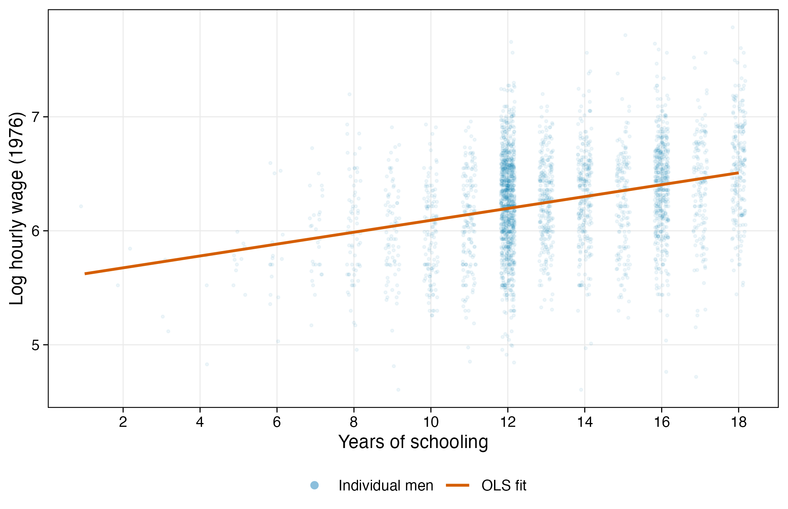
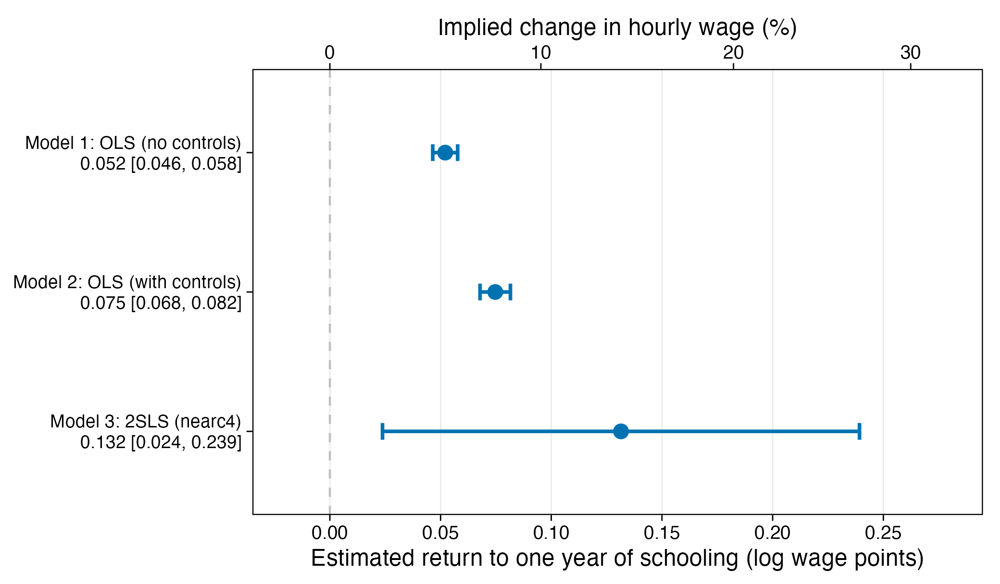

Tutorials for [Responsibly Deploy AI in Quantitative Social Research](https://github.com/reycn/llm-social-research-pku)

## For NUS students
- **Tut: Prompt**
1. Download [Antigravity](https://antigravity.google/)
2. Create a new project with an empty folder
3. Under that project, create a conversation, select permission level, and chat using the following prompt: 
```

Initiate a minimal research project according to https://github.com/reycn/agent-research-docs/blob/main/PROJECT.md , in which i want one script to replicate and explore Card 1993 (Using Geographic Variation in College Proximity to Estimate the Return to Schooling)

The research question is the effects of education on income.

First create this R script and install necessary packages.

Second, explore the correlation between education and income, plot a scatter plot according to the rules in https://github.com/reycn/agent-research-docs/blob/main/FIGURE.md

Third, run Model 1, an ordinary least square regression `lwage ~ educ`; Model 2, and ordinary least square regression with covariates controls <- c(
  "black", "south", "smsa", "smsa66",
  paste0("reg66", 2:9),  # region 1 is the reference category
  "exper", "expersq"
)

Lastly, (a) plot the effect sizes in two models according to the rules in https://github.com/reycn/agent-research-docs/blob/main/FIGURE.md; (b) report a paragraph by a topic sentence of our results, brief results of statistics, estimated changes that make sense to readers, and one interpretation of the results; according to the rules in https://github.com/reycn/agent-research-docs/blob/main/LATEX-APA.md, https://github.com/reycn/agent-research-docs/blob/main/STATISTICS.md, and (c) generate a markdown table according to the rules in https://github.com/reycn/agent-research-docs/blob/main/TABLE.md.

Please note that all numbers, tables, and figures should be exported directly by R functions.
```

## For PKU students
- Tutorial 1. Text classfication using Roberta*.  
  [[Google Colab]](https://colab.research.google.com/github/DhavalTaunk08/NLP_scripts/blob/master/sentiment_analysis_using_roberta.ipynb)

- **Tutorial 2. Text classfication using LLM**  
  [[Notebook]](./tut2.classification/genai.classification.ipynb). 
  [[Google Colab]](https://drive.google.com/drive/folders/1_G5N1JyovMMN8A0jJ4W_HUmg1HrpyoFk?usp=sharing)

- **Tutorial 3. Agentic modelling in data analysis**  
  [[Paper]](https://www.nber.org/papers/w4483). [[Simplified Replication by Agent]](./tut3.agentic.modelling). [[Prompt to replicate]](./tut3.agentic.modelling/Prompt.txt)

  | Figure 1 | Figure 2 |
  |:---:|:---:|
  |  |  |

  Table 1. Returns to Schooling Estimated by OLS and 2SLS

  |Variable           | Model 1 b (SE) | Model 1 95% CI | Model 2 b (SE) | Model 2 95% CI | Model 3 b (SE) | Model 3 95% CI |
  |:------------------|:--------------:|:--------------:|:--------------:|:--------------:|:--------------:|:--------------:|
  |Years of schooling |  .052 (.003)   |  [.046, .058]  |  .075 (.003)   |  [.068, .082]  |  .132 (.055)   |  [.024, .239]  |
  |Black              |      ---       |                |  -.199 (.018)  | [-.235, -.163] |  -.147 (.054)  | [-.252, -.041] |
  |South              |      ---       |                |  -.148 (.026)  | [-.199, -.097] |  -.145 (.027)  | [-.198, -.091] |
  |SMSA               |      ---       |                |  .136 (.020)   |  [.097, .176]  |  .112 (.032)   |  [.050, .174]  |
  |SMSA in 1966       |      ---       |                |  .026 (.019)   | [-.012, .064]  |  .019 (.022)   | [-.024, .061]  |
  |Experience (years) |      ---       |                |  .085 (.007)   |  [.072, .098]  |  .108 (.024)   |  [.062, .155]  |
  |Experience squared |      ---       |                |  -.002 (.000)  | [-.003, -.002] |  -.002 (.000)  | [-.003, -.002] |
  |Region controls    |       No       |                |      Yes       |                |      Yes       |                |
  |N                  |     3,010      |                |     3,010      |                |     3,010      |                |
  |R-squared          |      .099      |                |      .300      |                |      .238      |                |
  |Adjusted R-squared |      .098      |                |      .296      |                |      .234      |                |
  |First-stage F      |      ---       |                |      ---       |                |     13.256     |                |

  *Note.* Standard errors are in parentheses and 95% confidence intervals are in brackets. The dependent variable is the log hourly wage in 1976. All models use the 3,010 men in the NLS Young Men cohort with valid schooling and wage data. Region controls are indicators for the nine census regions in 1966 (reg662 to reg669), with the Northeast (reg661) as the reference category. Model 3 instruments years of schooling with nearc4, an indicator for growing up in a labor market with a four-year college; the first-stage F statistic refers to the excluded instrument.

- **Tutorial 4. Critically evaluate LLM-generated review comments**  
  [[Paper]](https://academic.oup.com/joc/advance-article/doi/10.1093/joc/jqag018/8858993). [[File]](./tut4.ai.review.critical/chen.and.kim.2026.pdf). [[Review]](./tut4.ai.review.critical/chen.and.kim.2026.ai.review.mhtml). [[Tool]](https://github.com/ChicagoHAI/OpenAIReview)

- Tutorial 5. Object detection using YoLo *  
  [[Notebook]](./tut5.object.detection/object.detection.ipynb).
  [[Google Colab]](https://drive.google.com/drive/folders/1_G5N1JyovMMN8A0jJ4W_HUmg1HrpyoFk?usp=sharing)

- Tutorial 6. Stimulus generation using multimodal model *   
  [[Link]](https://bfl.ai/models/flux-3-image)

*Note.* Tutorials marked with * are not going to be covered in this session, but they are free to explore.